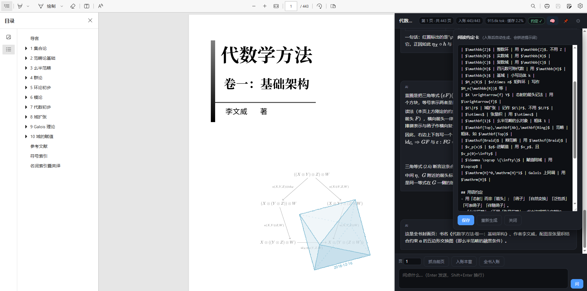
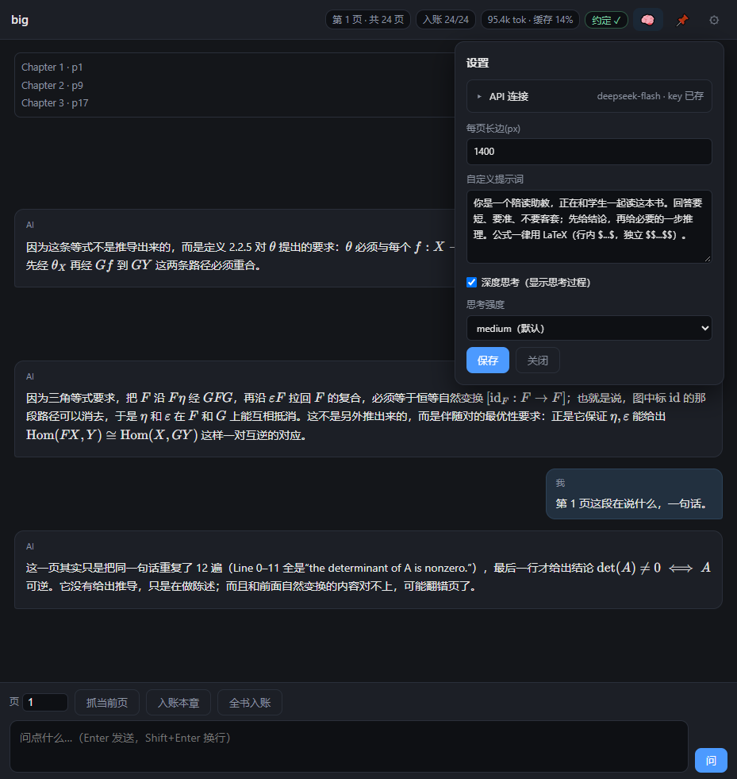

# AI 批注

把 PDF 拖到一个快捷方式上 → 用 Edge 原生阅读器打开书 → 右侧浮着一位能看懂你圈画的 AI 助教。

用一个窗口同时装下「书」和「AI」：左边是 Edge 内置的 PDF 阅读器（画笔、荧光笔、橡皮、保存全都在），
右边是紧贴书页的面板。圈一段、问一句，它看的是你此刻屏幕上的那一页。



## 特性

- **单窗口**：不改 Edge、不套壳，PDF 由浏览器原生渲染，绘制与保存原样可用
- **看图回答**：抓取书页画面（含你刚画的圈）送给视觉模型，不需要按 Ctrl+S 保存
- **逐页入账**：把页面转成 Markdown + LaTeX 存到本地，之后提问不再重复花钱
- **阅读约定卡**：入账后自动总结这本书的符号与术语写法，拼进提示词，让回答和书里一致
- **三段式回答**：思考过程（可折叠）→ 初稿 → 核查后的最终答案，后两段可关
- **每本书一个记忆容器**：目录、转写、约定卡、聊天记录，全部放在本地文件夹里
- **省钱导向**：命中缓存实时可见，单次提问约 1–2k token



## 快速开始

### 方式一：下载发行包（推荐，无需装任何环境）

到 [Releases](../../releases) 下载 `AI批注-vX.zip`，解压后：

1. 把 `AI批注.lnk` 拖到桌面（快捷方式存的是相对路径，整个文件夹搬家也不会失效）；
2. 把任意 PDF 拖到这个快捷方式上；
3. 首次使用点面板右上角 ⚙，填入 API key（地址与模型已配好）。

包内自带嵌入式 Python 3.12 与依赖，Windows 10/11 + Microsoft Edge 即可运行。

### 方式二：从源码构建

```powershell
git clone <this-repo>
cd <repo>
powershell -ExecutionPolicy Bypass -File .\build.ps1
```

脚本会自动：下载嵌入式 Python → 装依赖（PyMuPDF / Pillow / numpy / websocket-client）
→ 拉取 KaTeX 与 marked → 组装成 `dist\AI批注\` 并打成 zip。
需要联网；国内镜像已内置。

开发时也可以直接跑：`python app\server.py --port 8760`，浏览器打开 `http://127.0.0.1:8760/`。

## 目录结构

```
app/
  launcher.pyw   拖拽入口：建记忆容器、起后端、开 Edge 窗口
  server.py      本地 HTTP 服务（127.0.0.1，仅本机）
  reader.html    单窗口布局：原生 PDF + 右侧面板
  panel/         面板前端（原生 JS + KaTeX，无框架）
  cdp.py         DevTools 协议：抓书页画面、读当前页码
  ingest.py      逐页转写（图 → Markdown + LaTeX）
  prompt.py      提示词拼装（自定义 → 约定卡 → 目录 → 记忆）
  book.py        PDF 读写（PyMuPDF）
  store.py       记忆容器（文件即数据库）
  win.py         Win32 窗口操作
config.sample.json  配置模板（复制成 config.json 使用）
build.ps1           一键打包
```

## 工作原理（几个关键点）

- **单窗口**：`reader.html` 用 `file://` 打开，内嵌 `file://` 的 PDF（`http://` 页面嵌 `file://` 会被浏览器拦掉）；
  面板是叠在上面的另一个 iframe，位置按书页矩形计算，右缘顶到窗口右侧。
- **抓图**：内嵌 PDF 跑在独立渲染进程（OOPIF），CDP 截图和 `PrintWindow` 都拿不到；
  最终用「窗口置前 + 屏幕截取 + 按纯白像素自动裁到书页」。
- **缓存友好**：系统提示词顺序是 `自定义 → 约定卡 → 目录 → 记忆`，稳定内容在前，命中率常见 40%–90%。

## 费用

一次性入账：400 页左右的书约 0.5–1 元。
每次提问：1–2k token，同一页追问会命中缓存，再便宜一个数量级。

## 已知限制

- 只支持 Windows（依赖 Win32 与 Edge）
- 面板位置按「整页适配」推算；若你用 Ctrl+滚轮放大，需要等下一次抓图后才会重新贴合
- 抓图要求程序窗口在前台，被完全遮挡时抓到的是别的画面
- 只适配 OpenAI 兼容接口，默认面向 DeepSeek（`deepseek-flash` 支持图像输入）

## 隐私

- 服务只监听 `127.0.0.1`，不对外开放端口
- 书、笔记、聊天记录都留在本地程序目录
- 提问时会把**当前页截图和问题**发给你配置的模型服务商
- 仓库与发行包内**不含任何 API key**

## License

MIT